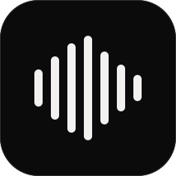
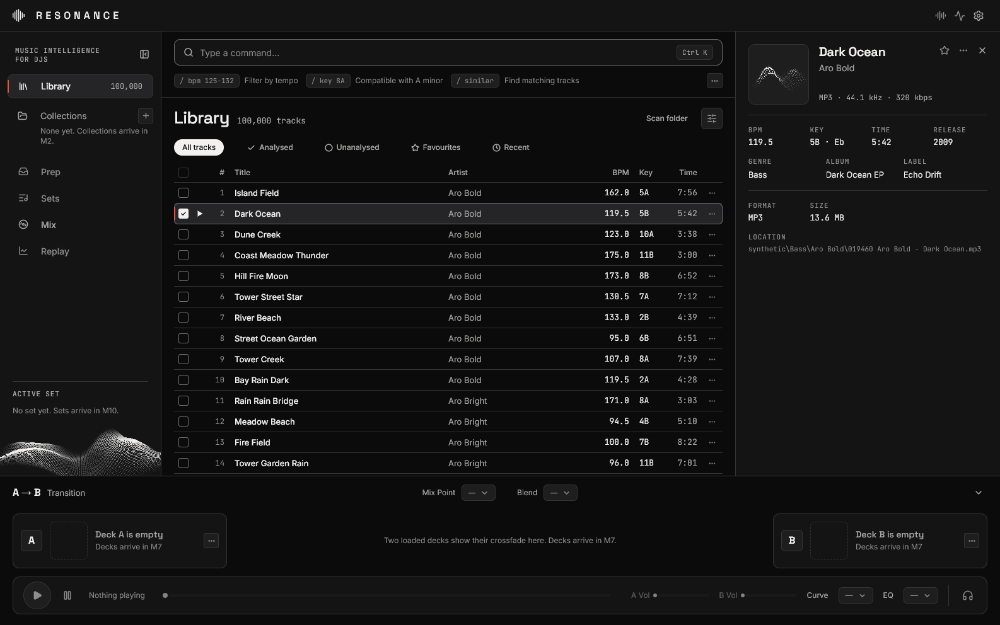
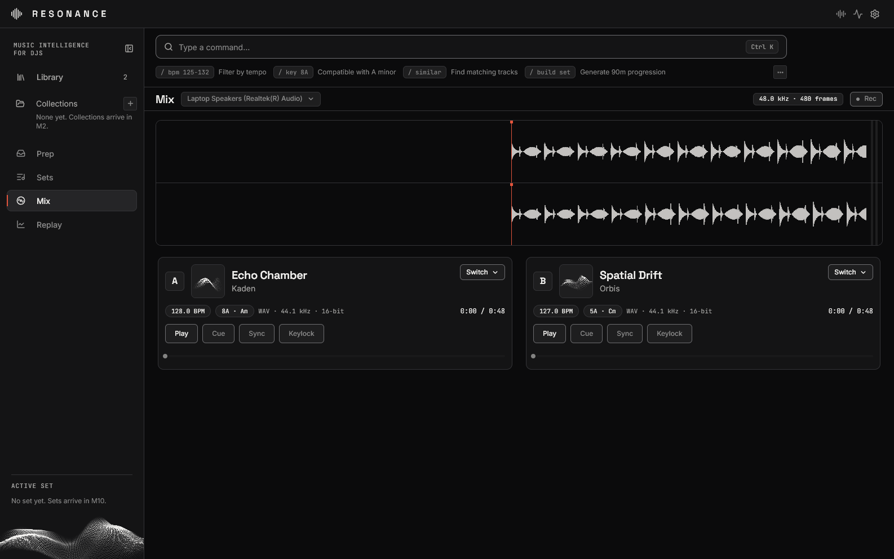
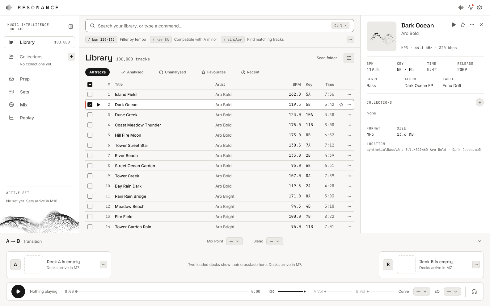

# Resonance

Desktop app for DJs: music library, tagging, audio analysis, mixing with live coaching, and review of recorded mixes.

<br clear="left" />

Most DJs will keep playing on their own hardware. Resonance is where they prepare a library without moving or touching their files by surprise, practise transitions with live feedback on timing, phrasing and master levels, and review recorded mixes afterwards.

<picture>
  <source media="(prefers-color-scheme: light)" srcset="docs/images/library-light.png" />
  
</picture>

| Mix view                                                                                 | Light theme                                                                       |
| ---------------------------------------------------------------------------------------- | --------------------------------------------------------------------------------- |
|  |        |
| Two decks decoding real audio with WebGL2 waveforms locked to the audio clock.           | The same shell, tokens and seeded dot-wave artwork in the warm-stone light theme. |

## What works today

- Watched music folders with per-subfolder toggles and an editable ignore list (`SourcesSettings.svelte` and `notify` filesystem watching), scanning read-only into SQLite (`WAL` mode) across MP3, FLAC, WAV, AIFF and M4A (`AAC` and `ALAC`, including files carrying stray leading ID3v2 headers).
- Track and asset identity by BLAKE3 byte hash, full-scale `i32` decoded-audio hash (`symphonia` gapless + stream checksum verification) and 120-second Chromaprint (`rusty-chromaprint`), keeping track identity intact when files are renamed, moved or retagged outside the app, with missing-file flagging and one-click or manual relinking across moved or re-encoded copies.
- A persistent Activity queue for scans and identity work that survives restarts, with progress, cancel and retry, and chunked scanning that keeps a 3,000-file scan responsive.
- Instant SQLite `FTS5` text search, filter drawer (`BPM`, key, year, label, format and missing files), quick pills (`All tracks`, `Favourites`, `Recent`), sortable columns and manual `track_id`-keyed collections across a virtualised 100,000-track table (`4.2 ms` median frame at 240 Hz, `<= 25.4 ms` p95 search and filter queries, `0.42 s` warm cold start).
- Track preview playback in `PlayerBar` (`rubato` sinc resampler feeding a lock-free ring buffer with a 5 ms ramp, interactive `ScrubBar` seeking and automatic Mix handoff), alongside a track inspector showing seeded dot-wave artwork, tags, Camelot key, format specs and file location.
- Identification in six steps: the file's own tags and name, an AcoustID fingerprint, name searches on MusicBrainz, Discogs, Deezer and iTunes, a check by ear against 30-second store previews, and a pasted release link (Bandcamp, SoundCloud, YouTube, Discogs or MusicBrainz). Bandcamp track pages are also tried from the file's own names, without searching Bandcamp. Keys live in the OS credential store, and the paid AudD recogniser runs only with a token.
- Prep, a review inbox for tagging: one list sorted by status, genre, label or year, every tag beside its suggestion with an accept button, a choice of covers side by side, keyboard-only batch tagging, and tag writing for MP3, WAV, AIFF, FLAC and M4A through a checked copy with undo. The mix goes into the title in brackets, as DJ software reads it.
- Filename templates, embedded and online cover art, library columns you choose and order, filters on any field and auto-preview while moving through the table.
- Two-deck Mix view playing audio through WASAPI with scrolling WebGL2 peak and RMS waveforms, binary playhead and meter telemetry, and 0 audio underruns across three-minute full-window runs. Exclusive mode runs at a 256-frame buffer (5.3 ms at 48 kHz) with 0 dropouts in the `v0.3.0` bench.
- Full M1 design system in dark, light and Windows high-contrast themes (`tokens.css` and 25 Svelte 5 primitives, shown side by side at `/design.html`), keyboard navigation (`Ctrl+K`, `1`–`5`, `[`, `I`, `D`, `Space`, `C`, arrow and selection keys), and browser hot reload against a local Rust core without rebuilding Rust for UI changes.

## Status

`M0 Foundations` (`v0.1.0`), `M1 Design` (`v0.2.0`), `M2 Library` (`v0.3.0`) and `M3 Identify and tag` (`v0.4.0`) are complete. M3 added the identification pipeline (`#124`) and its store searches and preview checks (`#148`), staging (`#125`), tag writing (`#129`), filename templates (`#130`), artwork (`#134`), library columns (`#135`), auto-preview (`#137`), filters (`#138`), and the Prep space (`#139`) with its review inbox (`#149`, `#153`). One budget carries over to `v0.5.0`: a 35.5 ms task on the UI thread while the desktop app starts (`#154`).

After `M3`, the roadmap builds quality checks and journaled file replacement (`M4`), beat/key/energy/phrase analysis (`M5`), similarity and natural-language discovery (`M6`), full deck controls and hardware mappings (`M7`), live mix coaching (`M8`), session replay (`M9`), set building (`M10`), rekordbox and Engine DJ library sync (`M11`), and stems (`M12`). Every checklist item and its evidence live in [docs/roadmap.md](docs/roadmap.md).

## Install

Windows x64 installers (`Resonance_0.4.0_x64-setup.exe`, and [`v0.3.0`](https://github.com/BradHudsonGrant/RESONANCE/releases/tag/v0.3.0), [`v0.2.0`](https://github.com/BradHudsonGrant/RESONANCE/releases/tag/v0.2.0) and [`v0.1.0`](https://github.com/BradHudsonGrant/RESONANCE/releases/tag/v0.1.0) before it) are attached as pre-releases on the [GitHub releases page](https://github.com/BradHudsonGrant/RESONANCE/releases). Running the setup installs Resonance for the current user at `%LOCALAPPDATA%\Resonance\resonance-app.exe`.

To build the installer from source instead, install the prerequisites under [Build](#build), run `npm ci --prefix ui`, and run:

```powershell
just installer
```

That writes `target/release/bundle/nsis/Resonance_<version>_x64-setup.exe` with build-machine paths stripped out and third-party licence notices bundled.

## Build

### Prerequisites

- Windows 10 or 11 (x64).
- Visual Studio C++ build tools and the Windows SDK (`Desktop development with C++`), required by Rust's `x86_64-pc-windows-msvc` target.
- Rust `1.100.0` with `rustfmt` and `clippy`, pinned in [rust-toolchain.toml](rust-toolchain.toml). With [rustup](https://rustup.rs) installed, run `rustup toolchain install` in the repository root.
- Node.js 24 (with `npm`).
- [`just`](https://github.com/casey/just) `1.59.0`, [`cargo-deny`](https://github.com/EmbarkStudios/cargo-deny) `0.20.2`, [`typos-cli`](https://github.com/crate-ci/typos) `1.52.2` and [`git-cliff`](https://github.com/orhun/git-cliff) `2.14.2`, matching [.github/workflows/ci.yml](.github/workflows/ci.yml) and [.github/workflows/release.yml](.github/workflows/release.yml):
  ```powershell
  cargo install just@1.59.0 cargo-deny@0.20.2 typos-cli@1.52.2 git-cliff@2.14.2 --locked
  ```
- Microsoft Edge WebView2 Runtime (included with Windows 11) for the Tauri window, and Microsoft Edge for the Playwright browser suite.

### From a clone to a running app

1. Clone the repository and install the UI dependencies (`just` keeps `CARGO_HOME` and `NPM_CONFIG_CACHE` inside `target/`):

   ```powershell
   git clone https://github.com/BradHudsonGrant/RESONANCE.git
   cd RESONANCE
   npm ci --prefix ui
   ```

2. Load tracks into the development library. Scan a music folder read-only into `target/dev/data` (and optionally run a foreground identity pass with `just identify`):

   ```powershell
   just scan C:\path\to\music
   just identify
   ```

   Or generate a 100,000-track synthetic library in `target/dev/synthetic`:

   ```powershell
   just synthetic-library
   ```

3. Run in a browser for day-to-day UI work (hot reload without compiling Rust). Start the local core in one terminal:

   ```powershell
   just serve
   # or against the synthetic library:
   just serve target/dev/synthetic
   ```

   Start Vite in a second terminal and open `http://localhost:5173` (`http://localhost:5173/design.html` shows every primitive in both themes):

   ```powershell
   just ui
   ```

4. Or open the packaged Tauri desktop shell:

   ```powershell
   just app
   # or against the synthetic library:
   just app target/dev/synthetic
   ```

5. Run the verification suite or measure the performance budgets:
   ```powershell
   just verify
   just bench
   ```
   `just verify` runs UI type checking, ESLint, Prettier, Vitest, Vite build, `cargo fmt`, `clippy`, `typos`, `cargo-deny`, Rust tests, IPC binding checks, Edge browser tests, third-party notices, version consistency and commit attribution checks. `just bench` opens the desktop app and Edge, plays audio through the output device, and writes a budget report to `docs/benchmarks/`.

## Docs

| File                                                       | What is in it                                                                               |
| ---------------------------------------------------------- | ------------------------------------------------------------------------------------------- |
| [docs/product.md](docs/product.md)                         | What Resonance does and the product rules every feature follows                             |
| [docs/roadmap.md](docs/roadmap.md)                         | Every milestone as a checklist, with linked evidence                                        |
| [docs/architecture.md](docs/architecture.md)               | Stack choices, crate boundaries, data model and performance budgets                         |
| [docs/transition-analysis.md](docs/transition-analysis.md) | Bar-synchronous feature storage, tuning maths, phrase compatibility and preference learning |
| [docs/design/](docs/design/)                               | Visual language, tokens, component layers, shell, Library, Mix, wave and contrast ratios    |
| [docs/adr/](docs/adr/)                                     | Architecture and design decision records                                                    |
| [docs/benchmarks/](docs/benchmarks/)                       | Build times and measured performance budgets                                                |
| [docs/v3-notes.md](docs/v3-notes.md)                       | Lessons carried forward from the previous app                                               |
| [CHANGELOG.md](CHANGELOG.md)                               | Release history generated from commits                                                      |
| [CONTRIBUTING.md](CONTRIBUTING.md)                         | Code, testing, documentation and release rules                                              |

## Stack

Rust workspace (`core`, `db`, `library`, `engine`, `jobs`, `api`, `cli`, `fixtures`), Tauri 2 on WebView2, Svelte 5 in strict TypeScript, SQLite (`WAL` + `FTS5`), `cpal` on WASAPI, `symphonia`, `lofty`, and custom WebGL2 waveform and dot-wave renderers. Windows first, with macOS and Linux planned on a bundled Chromium runtime (`M12`).

## Licence

Released under the [MIT Licence](LICENSE) ([ADR 0014](docs/adr/0014-open-source-under-mit.md)). Every runtime dependency is permissive (`MIT`, `Apache-2.0`, `BSD`, `ISC`, `Zlib`, `MPL-2.0`, `CC0-1.0`), enforced by `cargo-deny` in CI and bundled in [app/THIRD-PARTY-NOTICES.txt](app/THIRD-PARTY-NOTICES.txt).

Resonance is built and maintained solo; external pull requests are not accepted.
